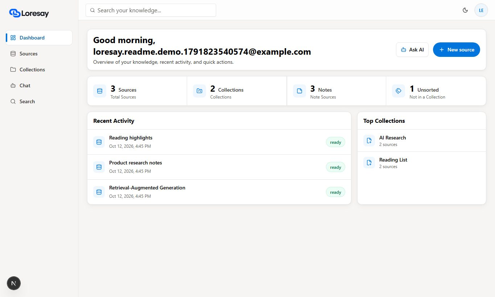
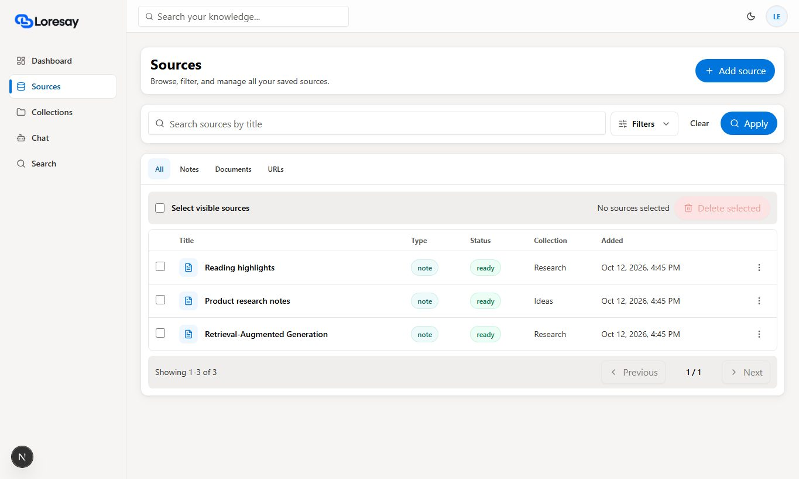
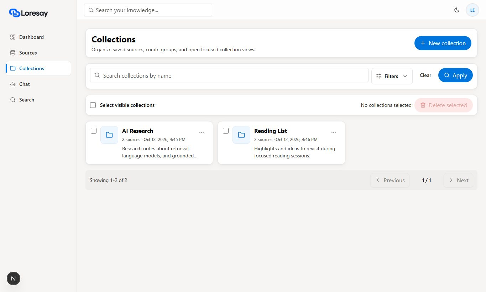

# Loresay

Loresay is a private AI knowledge workspace for saving notes, documents, and web sources, then asking questions and receiving grounded answers with citations.

## What the app does

- Captures notes, text documents, and web pages in one workspace.
- Organizes saved knowledge with collections, filters, and search.
- Generates answers grounded in the user's sources with visible citations.
- Supports source editing, reprocessing, archiving, export, and permanent purge.
- Keeps every workspace protected with Supabase authentication and row level security.

## Screenshots

| Authentication                                         | Dashboard                                             |
| ------------------------------------------------------ | ----------------------------------------------------- |
|  |      |
| **Sources**                                            | **Collections**                                       |
|    |  |

## Tech stack

| Area              | Technology                        |
| ----------------- | --------------------------------- |
| Application       | Next.js, React, TypeScript        |
| UI                | Tailwind CSS, Lucide React        |
| Database and auth | Supabase, PostgreSQL, Drizzle ORM |
| AI                | Vercel AI SDK, OpenAI or Gemini   |
| Testing           | Vitest, Playwright                |

## Running locally

```bash
git clone <your-repository-url>
cd Loresay
pnpm install
```

Copy `.env.example` to `.env.local`, add your Supabase credentials, and choose an AI provider. The stub provider works locally without paid API calls:

```env
AI_PROVIDER=stub
ANSWER_PROVIDER=stub
```

Start the development server:

```bash
pnpm run dev
```

Open [http://localhost:3000](http://localhost:3000).

## Checks

```bash
pnpm run quality
pnpm run test:e2e
pnpm run db:verify
```

## Deployment

The app is ready for a Node.js 24 deployment such as Vercel. Add the variables from `.env.example` to the deployment environment, connect the same Supabase project, and use `pnpm run build` as the production build command.
